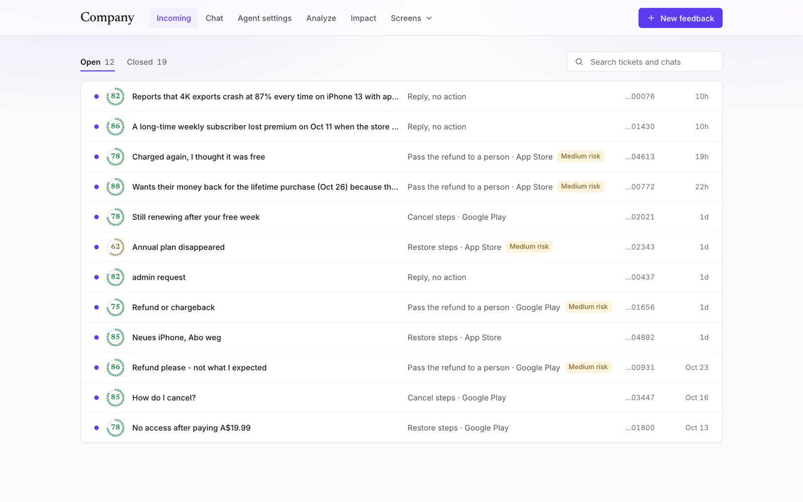
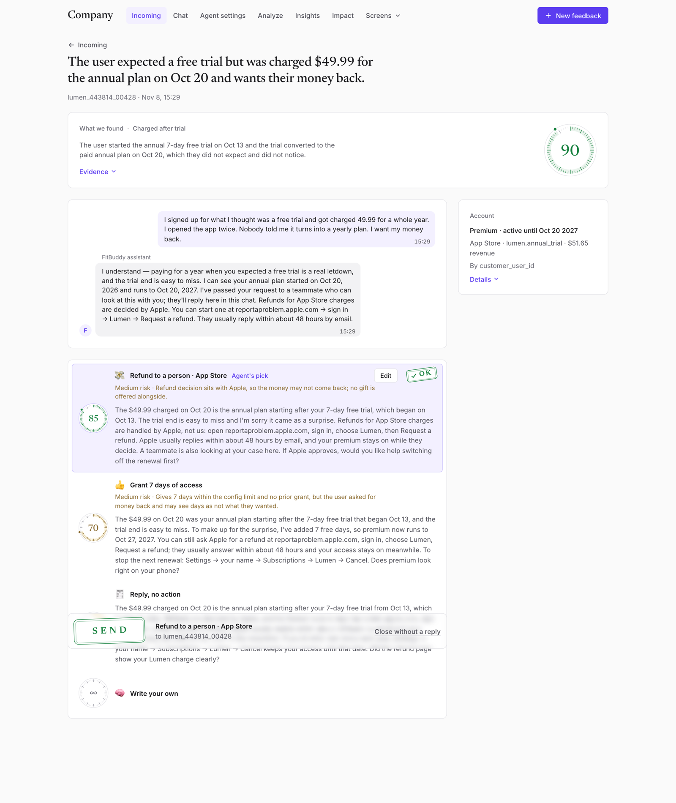
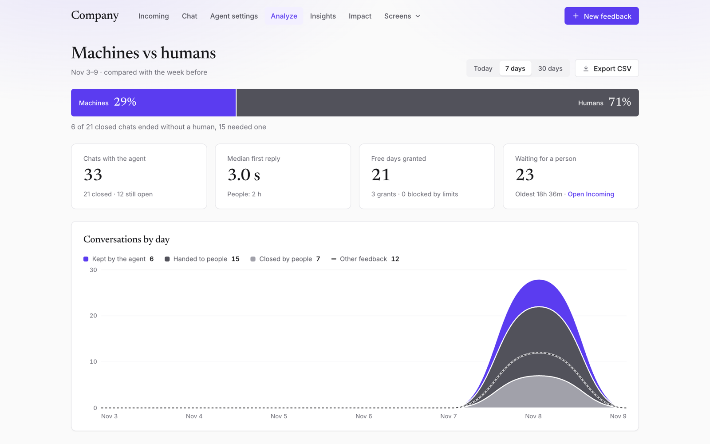
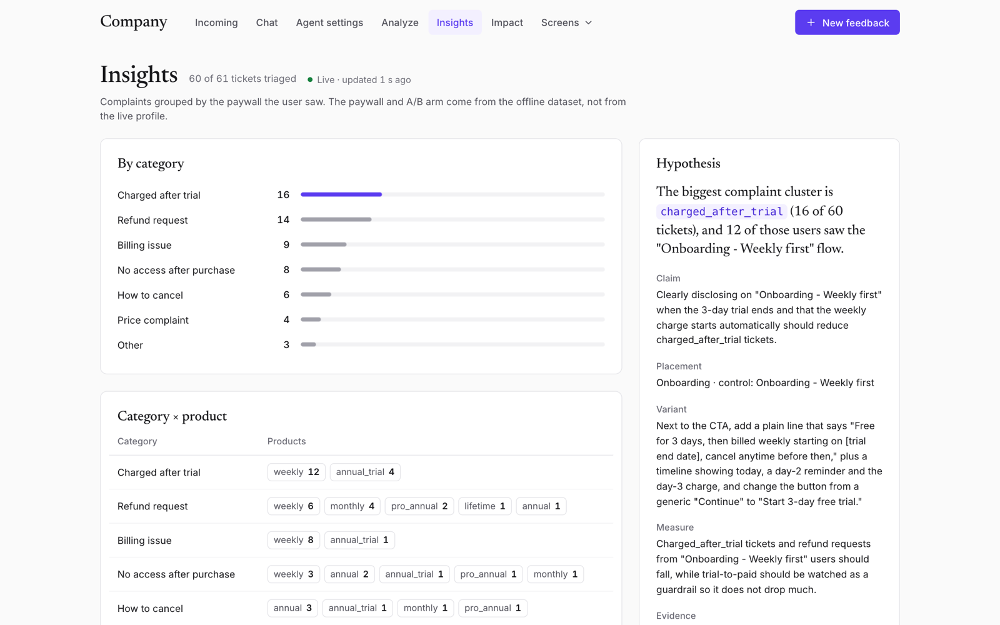
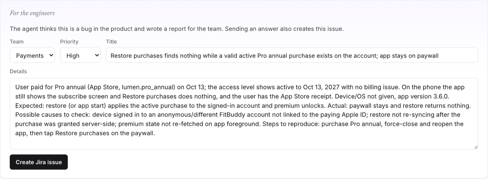
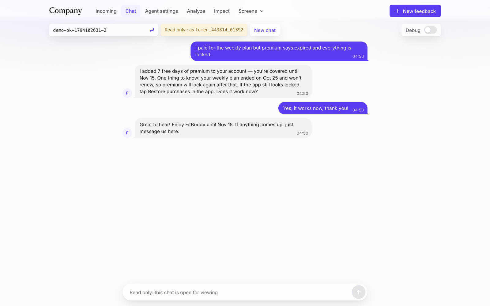
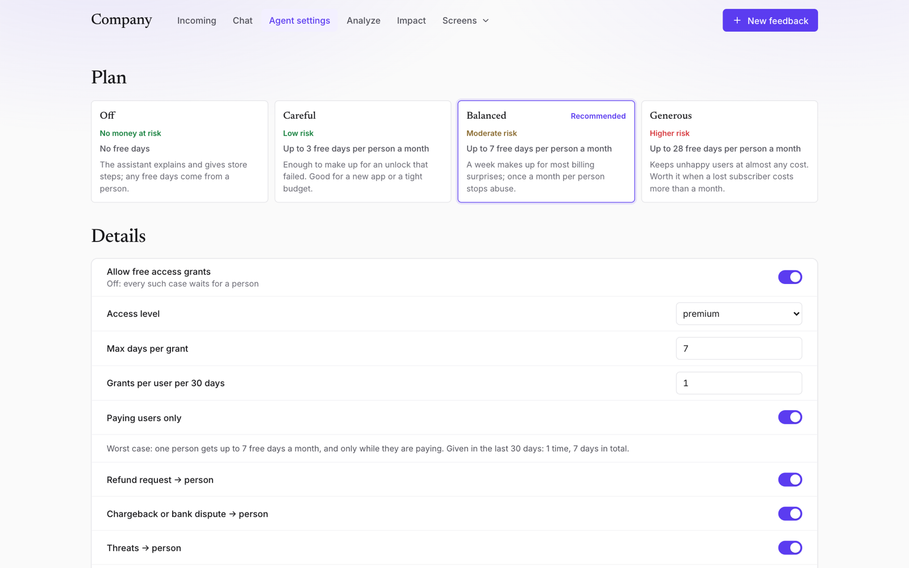
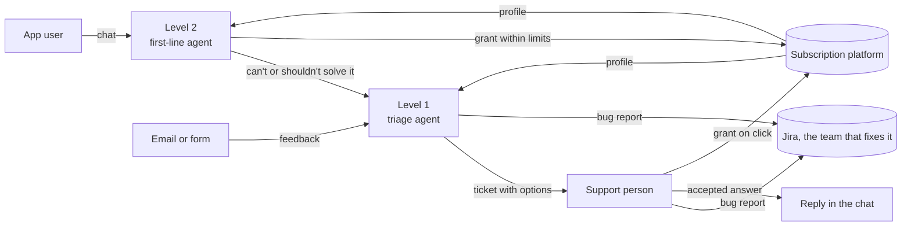

# Resolve

**AI support for subscription apps.** One agent talks to the app's users and fixes what is safe to fix. Another turns everything else into a ready ticket, so a person only has to pick an answer.

Most support questions in a subscription app are about money: "charged after the trial", "paid but still locked", "how do I cancel". The subscription platform already knows the truth about every purchase. Resolve reads it and acts on it, inside limits the app owner sets.

[Watch the 2-minute demo](https://www.youtube.com/watch?v=tm1e8iPP_tg)



## The screens

Screenshots of the running app. The chats and tickets are test data; the replies, options and scores come from the agents.

**Ticket.** The cause, the evidence and how sure the agent is, then answers that take different actions. The person sends one, edits it or writes their own. Nothing runs before that click.



**Analyze.** The agent and people compared on the same measures: who closed each chat, how fast the first reply came, how many free days went out.



**Insights.** Complaints grouped by the paywall the user saw, turned into one A/B test to try. It can create a draft test; nothing starts on its own.



**Bug reports to Jira.** When the cause is a defect in the product, the agent writes a report an engineer can act on and picks the team that fixes it. The person creates the issue with one click, sending the answer creates it too, or the owner lets the agent file on its own.



| Chat | Agent settings |
|---|---|
|  |  |
| **What the agent said and did.** A debug switch shows every tool call and whether the code allowed it. | **What the agent may do.** The owner picks the model, the tone and the limits. |

Also in the app: [Impact](docs/screenshots/impact.png), the numbers behind the problem with every source linked.

## Try it in a minute

No keys needed. This serves a saved snapshot, calls no model and writes nothing to the subscription platform. Requires Python 3.11+.

```bash
git clone https://github.com/svezhest/adapty-hackathon.git && cd adapty-hackathon
python3 -m venv .venv && source .venv/bin/activate
pip install -r requirements.txt
DEMO_MODE=1 python -m resolve --port 8010
```

Open <http://127.0.0.1:8010/ui>. Agents don't run in this mode, so see the demo video for live replies.

## How it works



- **Level 2, in the app.** Code loads the user's subscription profile before the model runs. The agent explains charges, plans and dates, gives the store's steps to restore, cancel or ask for a refund, and can grant free days.
- **Level 1, for the support person.** Every handoff and every other piece of feedback becomes a ticket. The agent finds the cause and proposes 2–3 answers with different actions, each with a ready reply and a risk. The user can write in any language; the person reads and decides in English.
- **Jira.** Each team has a project and a line on what it fixes, and the agent routes by that line. Code files one issue per ticket, removes email addresses and caps what the agent may file on its own in a day. The automatic mode is off by default.
- **Insights.** Code groups the triaged tickets and owns the numbers; the model writes the hypothesis, and code checks every cell and number it cites.

### What the model cannot decide

The limits live in code, not in the prompt, so the user can say anything and the answer doesn't change:

- Free days only for users paying now, within the owner's maximum, once per user per 30 days, and never for lifetime purchases.
- When a grant isn't possible, the model isn't offered the tool. If it calls it anyway, the code blocks the call and hands the chat to a person.
- Agents never refund. Only the store does, so a refund request always reaches a person.
- Refund demands, chargebacks, threats, "I want a human" and profiles that contradict the user go to a person.

## How accurate it is

Measured on DeepSeek `deepseek-flash`, on synthetic cases. Treat these as a first read, not a benchmark.

| Level 1: 38 cases, one run | Result |
|---|---|
| The first option has the right action | 29 (76%) |
| The right action is among the options | 37 (97%) |
| All options wrong | 1 (3%), and that case's label is debatable |
| Options with a forbidden action | 0 |
| Category correct | 37/38 |
| Evidence lines grounded in the loaded facts | 387/390 |

| Level 2: 23 scenarios, 2 runs each | Result |
|---|---|
| Passed all checks | 35/46 (76%) |
| Passed the code checks (right grant, handoff, store steps) | 40/46 |
| Reply claimed an action that didn't happen | 3/46 |

What to keep in mind:

- **The false claims are a known gap.** In one run the agent said it had added 7 days without making the call; in two it promised a handoff that didn't happen. The code checks the actions, not what the reply says about them. None of the Level 2 failures gave away money or access.
- **The cases aren't independent of the build.** Some were used for tuning, and Level 1 is scored on the action type, not on the reply text.
- **Level 2 has changed since this run** and wasn't measured again.
- **Raw results.** The Level 2 run is in `data/eval_l2_results.json`. The per-case file of the 38-case Level 1 run wasn't kept, so those totals can't be recomputed from this repo; `data/eval_results.json` is the earlier 32-case run.

## Why this problem

We read 21,825 App Store reviews of 74 top-grossing subscription apps. One in six negative reviews is about a purchase gone wrong, and 65 of the 74 apps have such complaints. Of the 353 reviewers who described contacting support, 2 said it helped. In about half of the complaints, the developer could fix the problem without Apple.

[Full research, method and limits](docs/market-research/README.md)

## What is real and what isn't

- **Real:** subscription profile reads, grants and the profile stamp, all on seeded demo users; the model calls of both agents; the limits and handoff rules.
- **Synthetic:** every ticket and chat message. No real end-user text is used. App Store reviews appear only in the research, never as tickets.
- **Not built:** email and App Store inboxes. "Reply sent" is a status for anything outside the chat, and nothing is emailed. The email → user index is filled by a script; in production it would come from the platform's webhooks.

The platform's server API finds a profile only by `customer_user_id` or `profile_id`, not by email or transaction, so Resolve keeps its own email index.

## Run it with live agents

The subscription platform behind this build is [Adapty](https://adapty.io), so `ADAPTY_SECRET_KEY` and `resolve/adapty.py` carry its name. "Company" in the screens is a placeholder. This is an independent project, not made or endorsed by Adapty.

```bash
cp .env.example .env   # fill in the keys, see the comments in the file
python -m resolve --port 8010
```

- **`ADAPTY_SECRET_KEY`:** the secret key of an app holding the demo users. To copy them into your own app, run `python scripts/seed_demo_profiles.py --yes` (`--one` first to check), then `python scripts/import_feedback.py` to add the hard cases.
- **The model:** `ANTHROPIC_API_KEY`, or `OPENAI_API_KEY` and `OPENAI_MODEL` for any OpenAI-compatible API (with `OPENAI_BASE_URL`). Agent settings can switch between them.
- **Seeded tickets** start untriaged: use **Run triage** on the ticket, or `python scripts/batch_triage.py`. Each run is a paid model call.
- **Jira (optional):** `JIRA_BASE_URL`, `JIRA_EMAIL` and `JIRA_API_TOKEN` for Jira Cloud; the teams and the automatic mode are in Agent settings.
- **`INSIGHTS_AUTO=0`** stops Insights from re-running on its own while the screen is open; the Run button stays.
- **`RESOLVE_DB=path`** runs on another SQLite file.

The server writes to the subscription platform and spends model credits. The API has no auth, so use `--host 0.0.0.0` only on a network you trust.

### Phone apps

Both call `POST /chat` on `http://<laptop-LAN-IP>:8010`:

- [`appy/`](appy/README.md): FitBuddy, the Expo showcase app with an in-app support chat.
- [`mobile-mock/`](mobile-mock/README.md): a minimal Android app with debug buttons.

## For developers

```bash
python -m pytest                    # no network, no keys
python scripts/export_openapi.py    # after any API change
python scripts/eval.py --yes        # calls a real model, costs money
```

| Where | What |
|---|---|
| `resolve/frontline.py` | Level 2 chat loop |
| `resolve/triage.py` | Level 1 and the Insights agent |
| `resolve/policy.py` | Limits, as pure code |
| `resolve/jira.py` | Bug reports to Jira: one issue per ticket |
| `resolve/actions.py` | The only place an action writes to the subscription platform |
| `resolve/workflow.py` | Accept, reject, reopen |
| `resolve/api.py`, `resolve/analytics.py` | JSON API and the numbers behind Analyze |
| `resolve/llm*.py` | One tool-calling interface for both providers |
| `resolve/static/ui/` | The web screens; `?mock=1` shows sample data with no requests |

**Docs:** [how the agents work](docs/agents.md) · [API schema](docs/openapi.json) · [design brief and tokens](docs/design/README.md) · [market research](docs/market-research/README.md) · [how AI was used to build this](docs/history/AI_LOG.md) · [rules for coding agents](AGENTS.md)

## What's next

- Group the same bug from different users into one Jira issue, and bring a fixed issue back to the ticket.
- Check what a reply claims against what the agent actually did.
- Email and App Store review inboxes into Level 1.
- Auto-accept low-risk options above a confidence threshold, once the eval is large enough to trust.
- A real retention offer instead of free days, such as store promo codes.
- Ask the platform for profile search by email or transaction in the server API, and a support scope for API keys.

## Credits

Built in two days at the Adapty Hackathon in Belgrade, 7–8 November 2026, by Team 12. This fork is Alex's continuation of the [team repository](https://github.com/Milos-Blagojevic/adapty-hackathon).

- **Alex Kryukov:** Level 1 and Level 2 agents, contract and API, LLM providers, web UI, mock APK, market research.
- **Milos Blagojevic:** v1 inbox and subscription API client, ticket generator, v1 eval, insights and A/B draft, pitch.
- **Dzhamal Abdulbasirov:** mobile showcase app.

The demo data comes from the organisers' [seed dataset](https://github.com/kpotehin/adapty-seed-data-hack). That is why ids read `lumen_*` while the app is called FitBuddy, and why a few older test replies still say Lumen.
