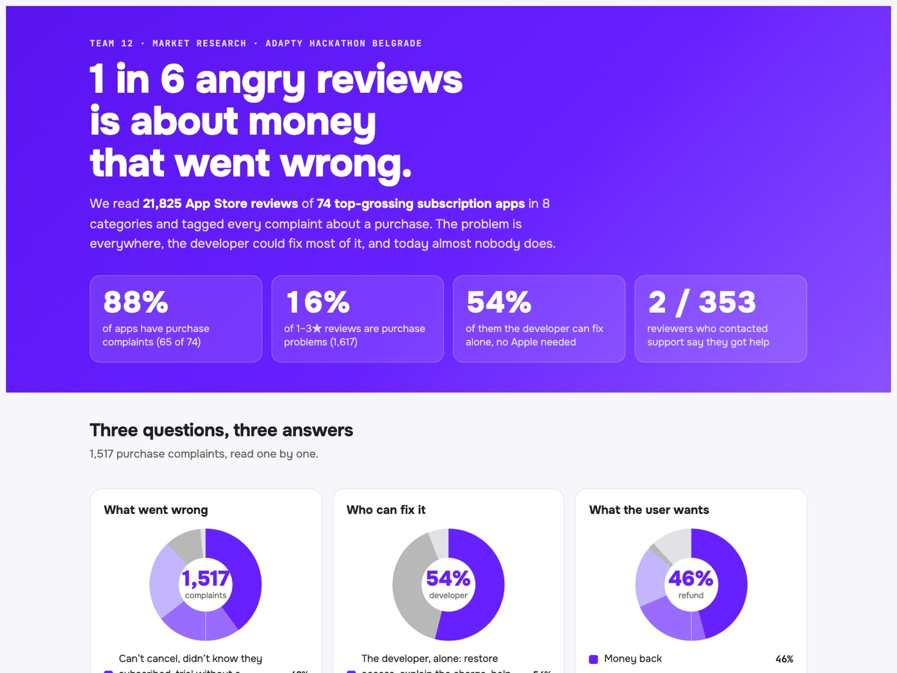

# Purchase Pain Index

What goes wrong after someone pays for a subscription app, according to the people who complained about it in public.

The full report is [`report.html`](report.html): download it and open it in a browser, since GitHub shows only the source.

## What we found

We took 21,825 App Store reviews of 74 top-grossing subscription apps in 8 categories. 9,963 of them gave 1–3 stars, and 1,617 of those (16%) are about a purchase problem. 65 of the 74 apps have at least one.

| What went wrong (1,517 complaints) | Share |
|---|---|
| Can't cancel, didn't know they subscribed, trial without a reminder | 40% |
| Charged after cancelling, surprise or double charge | 25% |
| Paid but no access: restore fails, still limited, credits missing | 23% |
| Refund refused or wanted | 11% |
| Payment fails | 1% |

- **Who can fix it:** the developer alone in 54% of complaints, only Apple in 40%, nothing to fix in 6%.
- **What the user wants:** money back 46%, to cancel 23%, access to what they paid for 18%, an explanation 2%, not stated 12%.
- **Support:** 353 reviewers describe contacting support. 202 got an answer that didn't help, 112 no reply, 37 only a bot, and 2 were helped.
- **Who is hit hardest:** mid-chart apps. Purchase problems make up 8.9% of all reviews at ranks 41–60 and 6.0% in the top 5.

## How we did it

1. **Collect.** Apple's public review feed, US store, top-grossing charts in 8 categories: the top 5 and 5 apps from ranks 41–60 in each. Social and streaming platforms and hardware companion apps are excluded. Up to 300 recent reviews per app; 92% were written in 2026.
2. **Label.** Claude Haiku classified every 1–3 star review, then read the purchase complaints again for pain, wish, support outcome, escalation, plan and who can fix it.
3. **Check.** A spot check of 10 random detailed labels found 8 correct.

## Limits

- **Reviews are public complaints, not ticket volume.** Most unhappy users write to support or their bank and never post a review.
- **The spot check is small.** 10 labels can't give a reliable error rate, so read the percentages as rough.
- **The detailed pass covers 1,517 of the 1,617 complaints.** The breakdowns above are based on those; `report.html` says all 1,617 were read again, but only 1,517 have detailed labels in `stats_v2.json`.
- **One store, one country, one moment.** US App Store only, November 2026. Google Play isn't covered.
- **The per-app rates rest on up to 300 reviews each,** so treat them as a signal to look closer, not as a verdict on an app.
- **We don't know which of these apps use the platform Resolve was built on.**

## What's in this folder

| File | What it is |
|---|---|
| `report.html` | The report |
| `stats_v2.json` | The numbers behind it |
| `apps.json` | The apps sampled (80 before filtering) |
| `pipeline/fetch_reviews.py` | Pulls reviews from Apple's public feed |
| `pipeline/hk/`, `pipeline/hk2/` | The labelling prompts and scripts for the two passes |
| `pipeline/stats_v2.py` | Merges the labels and computes the statistics |

**The review text isn't in this repo.** It belongs to the people who wrote it, and the numbers don't need it to be read. This also means the results can't be recomputed from here. `fetch_reviews.py` pulls the most recent reviews, so a new run gives a different sample, and the small step that cleaned the reviews and split them into batches (`reviews_clean.json`, `hk/in/`) wasn't kept.
